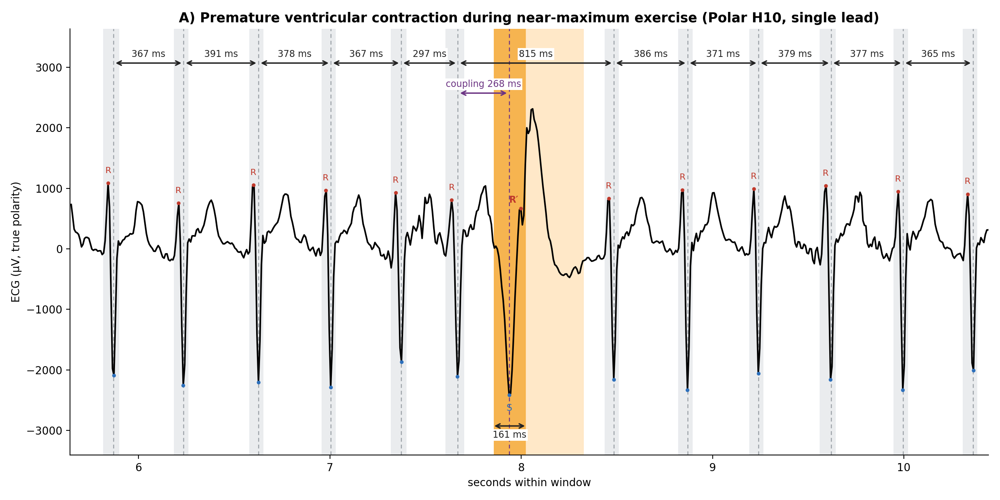
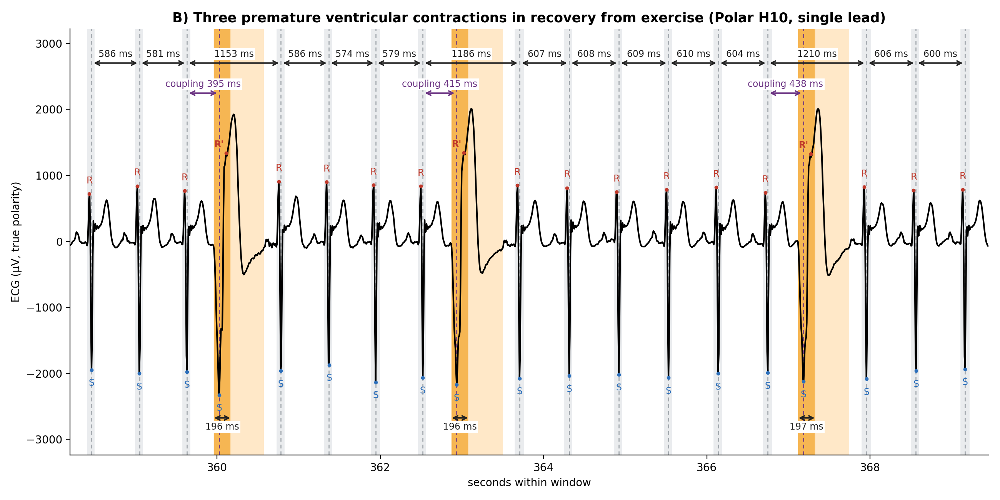
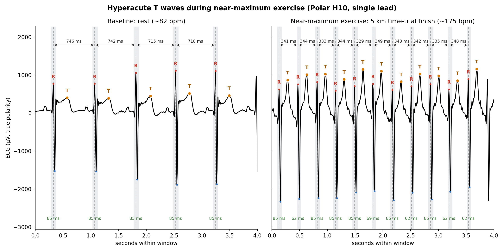
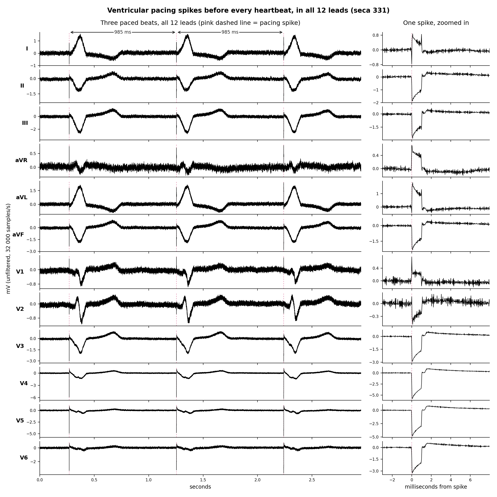
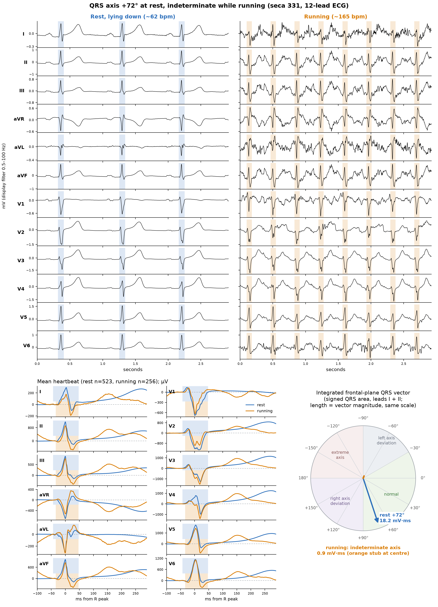

# What is OpenPhys

OpenPhys is an open source project focused on research-grade cardiac and physiology monitoring using a variety of (usually inexpensive) wearable sensors.

OpenPhys is suitable for affiliated and independent researchers.

OpenPhys can be used to research:

- cardiac arrhythmias
- autonomic nervous system
- sports cardiophysiology
- ischemia
- heart attacks (myocardial infarctions)
- high blood pressure (hypertension)
- time it takes for the heart to contract (left ventricular ejection time)
- detection of electrical pulses from a cardiac pacemaker
- sleep apnea/ snoring
- anything else, where single-lead ECG, (high-frequency) 12-lead ECG, three-axis accelerometer, or systolic/diastolic blood pressure measurements could be a source of valuable research data.

# What OpenPhys is not

OpenPhys is not medical software, and most of the sensors OpenPhys works with are not medical devices. OpenPhys is provided "as is" with no warranty (please see LICENSE.md for more details).

Even when a particular sensor OpenPhys works with is classified as a medical device, the way OpenPhys uses that sensor will almost surely invalidate the medical device status of that device when used in conjunction with OpenPhys. This is because OpenPhys usually needs to capture raw signal from the device, using a custom research-grade collection pipeline, and OpenPhys then analyses it using experimental methodology, with neither the source code nor the method reviewed or approved by the relevant regulator.

Do not rely on OpenPhys for medical or diagnostic purposes.

# Data sharing

When gathering data with OpenPhys you can opt into pseudonymous sharing of your data with the Institute for Open Physiology and the broader research community.

# Example capabilities

Here is a showcase of research capabilities of OpenPhys

The de-identified data and the scripts used to produce every figure below are in [`examples/readme_figures`](examples/readme_figures/README.md).

## Exercise-induced Premature Ventricular Contractions (PVCs)

Detecting monomorphic (= each with the same shape; likely originating from the same location in the heart) premature ventricular contractions (= individual heartbeats that come from the bottom chambers of the heart and spread through the heart muscle more slowly than normal heartbeats) during A) near-maximum exercise and B) recovery from the exercise. The sensor used was Polar H10. The subject was later confirmed to have exercise-induced ischemia and focal left ventricular hypertrophy (overgrowth of the left ventricle) using medical-grade imaging.

*A) During near-maximum exercise (heart rate ~160 bpm). One wide ventricular beat (orange) arrives early (coupling 268 ms, against a normal beat-to-beat interval of ~370 ms) and is followed by a compensatory pause: the interval spanning it (815 ms) is about twice the interval of the surrounding sinus beats (= normal heartbeats). This means the heart's natural pacemaker (the sinoatrial or SA node) kept its regular rhythm through the PVC: the one normal beat that came during the PVC was blocked at the atrioventricular (AV) node, the electrical gateway between the upper and lower chambers, which was still busy "handling" the PVC. So the next normal beat arrived right on schedule. The ventricular complex lasts ~161 ms; a normal QRS lasts under 120 ms.*

*B) About 4 minutes after a 5 km rowing time trial. Each of the three ventricular beats (orange) has the same shape, arrives early (coupling 395–438 ms, against a normal beat-to-beat interval of ~600 ms) and is followed by a compensatory pause: the interval spanning each PVC beat (1153–1210 ms) is about twice the normal interval. Each ventricular complex lasts ~196 ms (normal beats usually last <120 ms).*

## Hyperacute T wave during near-maximal exercise

Detecting hyperacute T waves during near-maximal exercise in the same subject. The sensor used was Polar H10:

*Both panels share the same µV and time scale. Left: baseline at rest (~82 bpm); the T waves (orange) are about a third of the height of the R waves. Right: the finish of a 5 km time trial (~175 bpm); the T waves are tall and peaked and taller than the R waves (median T wave 1.04 mV against 0.39 mV at rest).*

## Electrical pulses from a cardiac pacemaker

Detecting electrical pulses from a cardiac pacemaker (vertical "jumps" in the waveform immediately before the heartbeat); different subject, the sensor used was seca 331

*Different subject, a cardiac pacemaker user. Every one of the 608 heartbeats in a 10-minute recording is preceded by a pacing spike. Left: three paced beats in all 12 leads; the spike (pink dashed line) appears at the same instant in every lead and is followed by a wide paced QRS. Right: the same ~1 ms pulse in each lead, its size and polarity set by the direction the lead looks from. Standard ECG filtering smooths these spikes away; the seca 331 recording is performed and presented unfiltered at 32,000 samples per second, preserving the individual electrical pulses from the pacemaker.*

## Indeterminate QRS axis during exercise

Detecting a marked reduction in the magnitude of the integrated cardiac vector during exercise (due to a change in the direction of the propagation of the electrical signal responsible for the contraction of the heart)

*Different subject, seca 331 with torso (Mason–Likar) electrode placement for both recordings, so they are directly comparable. Top: 3 seconds of recording on the same time and voltage scale, lying down (3 beats, ~62 bpm) and while running (8 beats, ~165 bpm), all 12 leads, QRS shaded (blue at rest, orange while running). Bottom left: the mean heartbeat in every lead (523 beats lying down, 256 while running at 162–172 bpm), aligned on the R peak and referenced to the 10 ms before QRS onset, with each QRS window shaded (global onset to J point across all 12 leads: 91 ms lying down, 81 ms while running). Bottom right: the QRS integrated over that window in leads I and II. Lying down, the net vector is 18.2 mV·ms and points at +72° (a normal axis). While running, a deeper S wave appears in leads II, III and aVF and the positive and negative parts of the QRS almost cancel: the net vector shrinks to 0.9 mV·ms (the short orange stub at the centre of the dial), so the axis is indeterminate.*

# Supported sensors

Currently supported sensors are:

- Polar H10, a consumer chest-strap with single-lead ECG + three-axis accelerometer capability; retail price of $89.95 USD. This is the best sensor to buy to start playing with OpenPhys.
- iHealth Neo BP5S, a wireless blood pressure monitor. Please note that while BP5S is not rated for continuous/ambulatory blood pressure measurement (please see section "What OpenPhys is not"), the project uses it in this capacity for research purposes; retail price of $79.99 USD.
- Seca CT 331 (which also retails as custo cardio 300 BT). A more serious, high frequency 12-lead ECG sensor. It's expensive to buy (~2000 GBP/ 2200 EUR), it might be easier to borrow from somebody for a few weeks to play with.
- Concept 2 rowing ergometer ~$990 USD (PM5 monitor is the version supported).
- Android and Apple smartphones for GPS + microphone + data collection capabilities. Location data is not shared for research purposes (we only share data on speed, which is derived from location data but in principle should not allow for de-anonymisation of participant's location). Microphone data is only collected following explicit user action (e.g. to record the sound of the heartbeat).

Our technical roadmap includes a list of other sensors we would like to support.

# Polar H10

Polar H10 is the best sensor to buy to start playing with OpenPhys. In the US it retails for $89.95 USD, it also has good global availability. It has excellent capabilities, which include:

* high quality single-lead ECG with signal collected at 130 Hz (130 times a second)
* three-axis accelerometer
* bluetooth streaming to a nearby device
* waterproof, robust and the strap can be machine washed
* comfortable and can be worn for days (and nights) at a time, including under the shower.

Slight disadvantages are:

* sometimes the bluetooth stream stops working and the best way to recover is to remove the battery for several seconds
* morphology of the ST-segment can look abnormal even in subjects with normal 12-lead ECG.

Prior work shows that the Polar H10 device can be used to reliably detect cardiac arrhythmias:

[Polar partners with Kardi AI for cardiac arrhythmia screening](https://www.polar.com/en/media-room/polar-partners-with-kardi-ai-cardiac-arrhythmia-screening)

With sufficient and representative participation, this project should eventually be able to reliably detect the following types of cardiac arrhythmia:

- Atrial fibrillation
- Atrial flutter
- Supraventricular tachycardia
- Ventricular tachycardia
- Premature atrial/supraventricular beats, and their burden
- Premature ventricular beats, and their burden.
- PAC/PVC couplets
- PAC/PVC bigeminy or trigeminy
- Sinus tachycardia / bradycardia
- Ectopic rhythms
- Ventricular fibrillation
- Heart block
- R-R pauses

The capability to continuously record 3-axis accelerometer data can additionally allow to:
* Detect sleep position (relevant in positional sleep apnea, e.g. supine sleep apnea). This can make it a relevant research tool in sleep disordered breathing.
* Detect breath in and breath out.
* Opening and closing of the aortic valve creates an accelerometer ripple in some of the axes for some of the human subjects; we expect Polar H10 to be capable of detecting the time it takes for the heart to contract (left ventricular ejection time) in at least a fraction of the population.

The project also aims to be able to measure left ventricular ejection time across a range of heart rates, as well as snoring and basic positional sleep analysis.

# How to use OpenPhys

TODO write that. In the meantime, see [TECHNICAL.md](TECHNICAL.md) for building and running the collector, cloud service and apps.

# How to install the Android and iOS apps

TODO write that