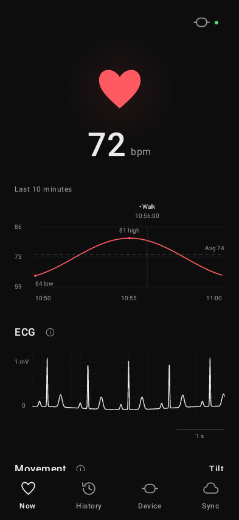
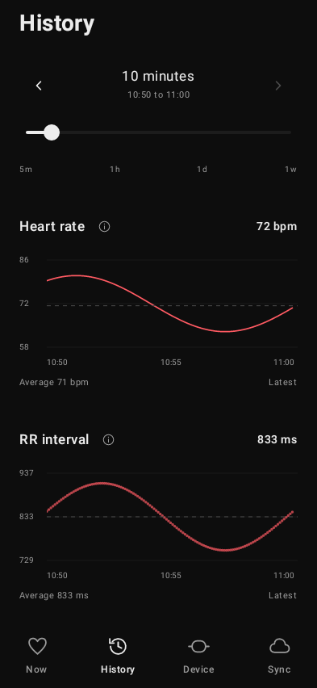
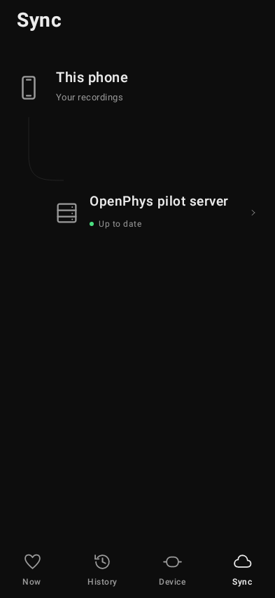

# Training Sensors for Android

Record Polar H10 ECG, motion, and heart rate.

<p>
  <a href="app/src/test/snapshots/Now-dark.png"></a>
  <a href="app/src/test/snapshots/History-dark.png"></a>
  <a href="app/src/test/snapshots/Sync-dark.png"></a>
</p>

*Demo readings. The hosted APK may differ from these previews.*

## Install

Needs Android 9+, a Polar H10, and a server account.

1. Open your email invitation and choose a password.
2. On your phone, sign in to your server, install the APK, then return and choose **Connect this phone**.
3. Complete sensor/background setup. Check fresh ECG, heart rate, contact, and uploads on the dashboard. Keep your phone nearby.

<details>
<summary>QR setup and connection help</summary>

- On a computer, select **Connect a phone with QR**. Scan to install, then re-scan to connect.
- Invitations expire after seven days; connection links after ten minutes.

</details>

<a name="invite-someone"></a>
<details>
<summary>Invite someone</summary>

Sign in as an administrator, open `/admin` on your server, and enter their email. Invitations are single-use. There is no public sign-up.

</details>

<a name="build-and-test"></a>
<details>
<summary>Build and test</summary>

Needs JDK 21 and Android SDK platform/build tools for API 34. Set `JAVA_HOME` and `ANDROID_HOME`. From the repository root:

```sh
cd android
./gradlew testDebugUnitTest testReleaseUnitTest lintDebug assembleDebug koverVerify koverXmlReport
```

The debug app uses `com.vineyardfinance.sensors.debug`. Signing keys, APK artifacts, credentials, and deployment state stay outside Git; local checks need none of them.

[Shared design and screenshot checks](../shared/README.md).

</details>
