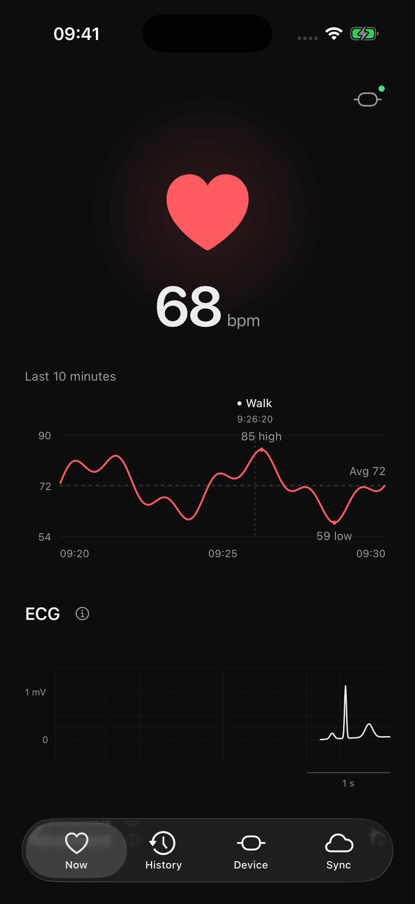
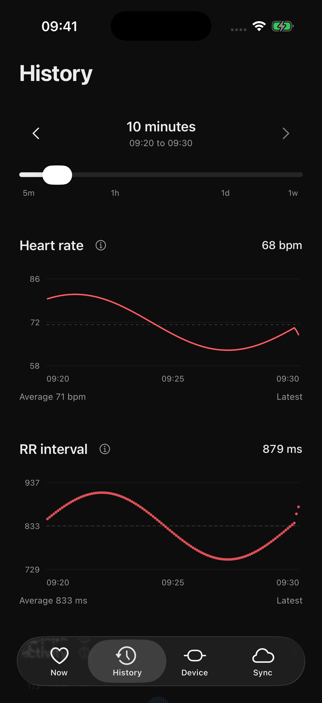

# Training Sensors for iPhone

Record Polar H10 ECG, motion, and heart rate on your iPhone.

<p>
  <a href="images/now.png"></a>
  <a href="images/history.png"></a>
</p>

*Demo readings.*

## Install

Needs iOS 17+, a Polar H10, and [SideStore](https://docs.sidestore.io/docs/installation/install).

1. Download the IPA from this repository's [Releases](https://github.com/institute-for-open-physiology/openphys/releases) to Files.
2. In SideStore, tap **My Apps > +** and choose it.
3. Open **Training Sensors**, allow Bluetooth, wet the strap pads, and wear the H10. Recording starts automatically.

Keep SideStore refresh enabled. Update over the existing app to keep your data.

No server account needed. **Sync** offers server uploads and Apple Health heart-rate export, both optional.

<details>
<summary>Apple Watch / build from source</summary>

SideStore installs only the iPhone app. The Watch companion mirrors iPhone readings; it cannot record alone.

Needs a Mac, Xcode 16+ with iOS and watchOS platforms, iOS 17+, and watchOS 10+.

From the repository root:

```text
brew install xcodegen
cd ios
xcodegen
open TrainingSensors.xcodeproj
```

1. Choose your team in **Signing & Capabilities** for both targets.
2. In the project's **Build Settings**, set `APP_BUNDLE_IDENTIFIER` to a unique ID, such as `com.yourname.trainingsensors`. The Watch adds `.watchkitapp`.
3. Enable Developer Mode on both devices.
4. Run `TrainingSensors` on the iPhone, then `TrainingSensorsWatch` on its paired Watch.

</details>

<details>
<summary>Publish to TestFlight</summary>

Create the app in App Store Connect using your own bundle ID, and set `APP_BUNDLE_IDENTIFIER` in `project.yml` to match.

Use a GitHub repo you control. Its default branch must contain this workflow. Add these repository secrets:

| Secret | Value |
|---|---|
| `APPLE_TEAM_ID` | Ten-character Developer Team ID |
| `APPLE_SIGNING_P12_BASE64` | Base64 Apple Development `.p12` from the paid team, including its private key |
| `APPLE_SIGNING_PASSWORD` | Certificate export password |
| `ASC_KEY_ID` | App Store Connect Admin team API key ID |
| `ASC_ISSUER_ID` | API key issuer ID |
| `ASC_PRIVATE_KEY` | Downloaded `.p8` contents |

In **Actions > iOS build and release > Run workflow**, select `ios-client` and enable **Upload iPhone and Watch apps to TestFlight**. Tests run before upload; export uses Apple cloud distribution signing. Increase the build number in `project.yml` for each new upload.

To upload from a Mac signed into Xcode instead, run from the repository root:

```sh
uv run --no-project python ios/scripts/testflight.py --team YOURTEAMID --upload
```

Use your ten-character Team ID. This archives and uploads both iPhone and Watch apps with Apple distribution signing. Omit `--upload` to export locally into `ios/dist/TestFlight/`.

Add the uploaded build to a TestFlight group in App Store Connect. External testers need beta review before you can share an invitation.

</details>

<details>
<summary>Package and test</summary>

CI tests and builds iPhone and Watch apps. Branch builds produce an IPA; new version/build numbers in `project.yml` publish [Releases](https://github.com/institute-for-open-physiology/openphys/releases) when merged into `main`.

Package from the repository root. Needs a Mac with Xcode, XcodeGen, and uv:

```text
uv run --no-project ios/scripts/package.py
```

The IPA and checksum go in `ios/dist/`.

Test H10Kit from the repository root:

```text
cd ios/H10Kit
swift test
```

</details>
